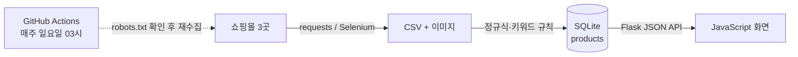
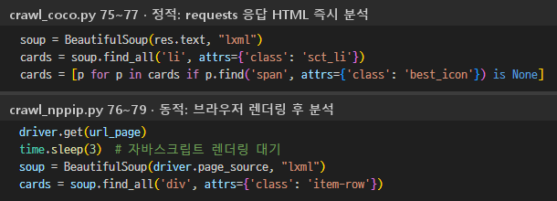
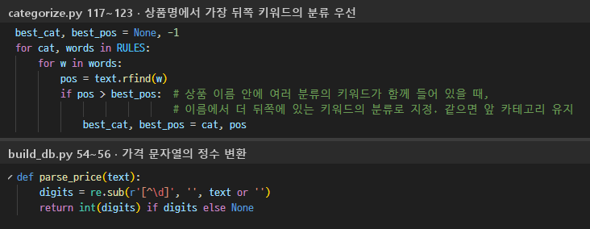
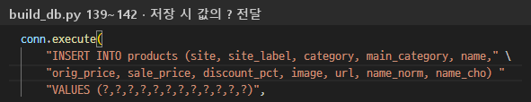
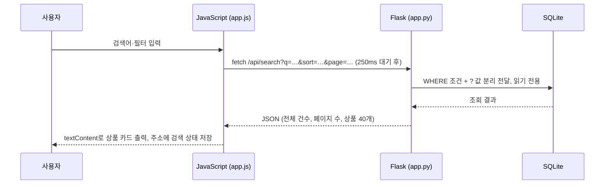
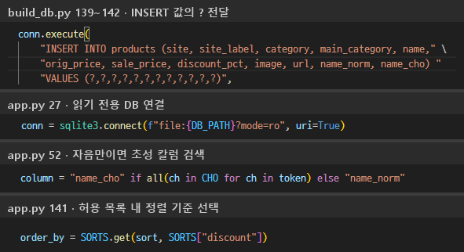

# 오카시에리 (Okashiro)

일본 과자 직구 쇼핑몰 3곳(코코재팬, 엔핍, 이로이로도쿄)의 상품을 한곳에서 검색하고 가격순으로 비교하는 웹사이트입니다.

> 쇼핑몰 데이터 수집·정제 → SQLite DB 구축 → Flask 기반 검색 서비스 구현

포트폴리오용 비공개 저장소입니다. 수집한 데이터는 개인 학습·시연 용도입니다.

| 항목 | 내용 |
|---|---|
| 문제 | 최저가 확인을 위한 사이트별 개별 접속·검색과 가격의 수동 비교 반복, 사이트마다 다른 표기·분류 기준 |
| 결과 | 쇼핑몰 3곳의 상품 5,585건을 하나의 DB로 모아 이름·초성 검색, 분류·가격대·할인율·쇼핑몰 필터, 가격순 정렬 제공 |
| 기술 | Python · requests · BeautifulSoup · Selenium · SQLite · Flask · JavaScript · GitHub Actions |

## 전체 구조



| 단계 | 파일 | 하는 일 |
|---|---|---|
| 데이터 수집 | `check_robots.py`, `crawl_coco.py`, `crawl_nppip.py`, `crawl_iroiro.py` | 수집 허용 확인, 쇼핑몰별 상품 수집 |
| 데이터 정제 | `okashiro/build_db.py`, `okashiro/categorize.py` | 가격 숫자 변환, 중복 제거, 공통 분류 |
| DB 구축 | `okashiro/build_db.py` | `products` 표 생성과 저장 |
| 검색 서비스 | `okashiro/app.py`, `okashiro/static/app.js` | 검색 API와 화면 |
| 자동화 | `.github/workflows/weekly-crawl.yml` | 매주 수집 → DB 생성 → 상품 수 검증 |

## 1. 데이터 수집

### 사이트 구조 분석

개발자도구(F12)로 상품 카드 하나의 HTML 구조를 확인하고, 상품 하나를 감싸는 반복 태그 단위로 수집했습니다.


빨간 박스: 상품 카드(`li.sct_li`) · 상품명(`sct_txt`) · 정가(`coco2-was`)·할인가(`coco2-now`)

| 사이트 | 유형 | 수집 도구 | 페이지 이동 |
|---|---|---|---|
| 코코재팬 | 정적 | requests | '더보기' 버튼의 내부 주소(AJAX) 직접 요청 |
| 이로이로도쿄 | 정적 | requests | 경로 번호 `/page/N/` |
| 엔핍 | 동적 | Selenium | URL 파라미터 `page=N` |

### 정적·동적 판별에 따른 수집 방법

같은 페이지를 requests와 Selenium으로 각각 받아 상품 개수를 비교해 판별했습니다. 엔핍만 requests 결과에 상품이 없어 Selenium으로 렌더링한 뒤 수집합니다. HTML을 얻는 방법만 다르고, 상품 카드를 찾는 방법은 같습니다.



### 수집 허용 여부 확인

처음에는 접속 가능(상태코드 200)만 보고 수집했지만, 접속 가능과 수집 허용은 다릅니다. robots.txt를 파싱해 수집할 주소마다 `can_fetch()`로 허용 여부를 판단했고, 재팬푸드몰은 사이트 전체가 금지라 서비스에서 제외했습니다. 지금은 매주 수집 직전에 자동으로 확인하고, 허용되지 않으면 수집을 멈춥니다.


### 수집 중 발생한 문제와 해결

| 문제 | 원인 | 해결 |
|---|---|---|
| 코코재팬 상품 일부 누락 | 고정 페이지 수 < 실제 페이지 수 (시험 수집으로 확인) | '새 상품 없음' 기준 종료, 수집 성공 시에만 CSV 교체 |
| 이로이로도쿄 같은 상품 반복 수집 | 마지막 페이지 이후 메인 페이지로 리다이렉트 (상태코드 200 유지) | 요청 주소와 응답 주소(`res.url`) 비교로 종료 |
| GitHub Actions에서만 코코재팬 403 | 응답 헤더 `cf-mitigated: challenge` → Cloudflare 봇 확인 (User-Agent 무관, PC 정상) | 우회 없이 코코재팬만 PC 수집 데이터 사용 |


## 2. 데이터 정제

DB로 만들기 전에 형식을 맞추고 누락·중복을 걸러 내는 전처리입니다.

| 구분 | 문제 | 처리 |
|---|---|---|
| 가격 | '1,900원' 같은 문자열 → 정렬 오류 | 정규식으로 숫자만 남겨 정수 변환 |
| 중복 | 같은 상품의 반복 저장 | 상품 주소 기준 제거, `UNIQUE(site, url)` 제약 |
| 분류 | 사이트별 분류 부재·기준 상이 | 상품명 키워드 규칙으로 공통 분류 10개 |
| 키워드 | 상품 종류는 상품명 끝에 오는 경향 | 가장 뒤쪽 키워드 우선 |

머신러닝 분류에 필요한 정답 라벨이 없어서 키워드 규칙을 택했습니다. 잘못 분류되면 원인 규칙을 바로 찾아 고칠 수 있습니다.



## 3. DB 설계와 구축

`products` 표 하나에, 칸마다 저장할 때 할 일과 조회할 때 쓰임을 정해 두었습니다.

| 구분 | 칼럼 | 저장할 때 (`build_db.py`) | 조회할 때 (`app.py`) |
|---|---|---|---|
| 식별 | `site` · `site_label` · `url` | `UNIQUE(site, url)`로 중복 저장 차단 | 쇼핑몰 필터, 상품 페이지 이동 |
| 상품 | `name` · `image` | 원본 상품명과 이미지 경로 | 상품 카드 표시 |
| 가격 | `orig_price` · `sale_price` · `discount_pct` | 문자열의 정수 변환, 할인율 계산 | 가격대·할인율 필터, 가격순 정렬 |
| 분류 | `category` · `main_category` | 쇼핑몰 원래 분류 보관, 공통 분류 10개 지정 | 분류 필터 |
| 검색용 | `name_norm` · `name_cho` | 공백 제거·소문자 이름, 초성 미리 계산 | 이름·초성 검색 |

- 읽기 위주의 소규모 데이터라 서버 설치가 필요 없는 파일형 DB인 SQLite를 썼습니다.
- 매주 수집 후 새 DB를 만들고, 상품이 3,000건 미만이면 실패 처리합니다.



## 4. 검색 서비스 구현



| 백엔드 · Flask | 프론트엔드 · JavaScript |
|---|---|
| 검색 조건별 WHERE 조립, 값은 `?` 파라미터로 분리 전달 (SQL 주입 차단) | 필터 변경 시 fetch로 데이터만 요청, 목록 부분만 다시 그림 |
| 정렬 기준은 허용 목록에서만 선택 (`ORDER BY`에는 `?` 사용 불가) | 입력 후 250ms 대기 뒤 요청, 늦게 도착한 이전 응답은 버림 |
| 읽기 전용 DB 연결(`mode=ro`), 범위를 넘는 페이지는 마지막 페이지로 보정 | 모든 글자를 `textContent`로 출력 (외부 상품명 속 스크립트 실행 차단) |
| 응답: 전체 건수·페이지 수·상품 40개의 JSON | 검색 상태를 주소(URL)에 저장 → 새로고침·링크 공유 시 유지 |



## 아쉬운 점

| 아쉬운 점 | 원인 | 개선 필요 사항 |
|---|---|---|
| 수집 완료 후 robots.txt 확인, 재팬푸드몰 서비스 제외 | 수집 가능 여부를 접속 성공(200)으로만 판단 | 접속 확인 단계의 robots.txt 확인 통합 |
| 오류 없는 종료 속 누락·반복 수집 | 사이트 끝을 고정 페이지 수로 가정, 수집 결과 검증 부재 | 응답 기반 종료 조건과 수집 건수 검증의 초기 설계 |
| 가격 변동 이력 소실 | 수집마다 DB를 새로 만드는 구조 | 수집 일자 기반 가격 이력 저장 구조 |

## 실행

```bash
git clone https://github.com/seo941024/Crawling.git
cd Crawling
pip install -r okashiro/requirements.txt
cd okashiro
python app.py        # http://127.0.0.1:5000
```

- CSV 3개와 `okashiro/okashiro.db`는 저장소에 포함되어 있어 바로 실행됩니다.
- **상품 이미지는 저장소에 없습니다**(용량·저작권). 수집 스크립트를 돌리면 받아지고, 없으면 화면에 "이미지 없음"으로 표시됩니다.
- 엔핍 수집에는 Chrome이 필요합니다.
- 수집 스크립트는 `--out-dir`(저장 폴더)와 `--max-pages`(시험 실행용)를 받습니다.

## 주간 자동 수집

GitHub Actions가 쇼핑몰별 robots.txt 확인 → 수집 → 새 DB 생성 → 상품 수 검증 순서로 실행하고, DB와 CSV를 결과물(Artifacts)로 30일 보관합니다. 코코재팬은 GitHub 서버 접속이 막혀 건너뛰고 저장소의 CSV를 사용합니다(PC에서 수집해 올림). Actions 화면에서 **Run workflow**로 수동 실행도 할 수 있습니다.

## 주의

- 쇼핑몰 약관이 정보의 복제·제공을 제한할 수 있으므로 공개하지 않습니다.
- 재팬푸드몰(robots.txt가 크롤러를 전부 금지)과 구루메상(운영 중단)은 서비스에서 제외했습니다. 두 곳의 수집 원본 CSV는 기록용으로만 저장소에 있고, 자동 수집과 사이트에는 쓰이지 않습니다.
