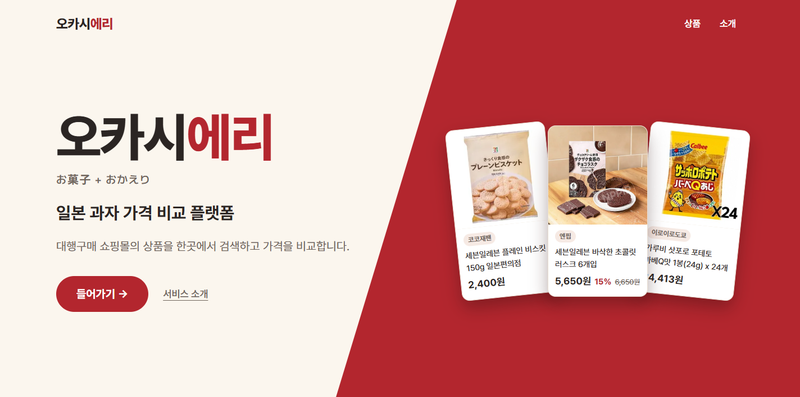
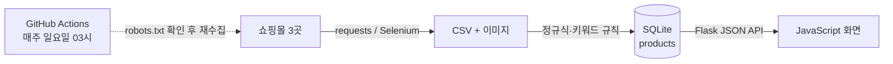
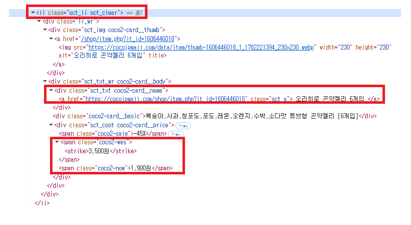
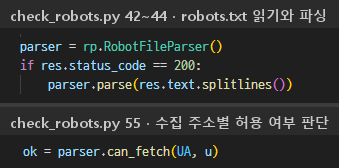
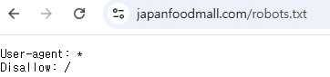
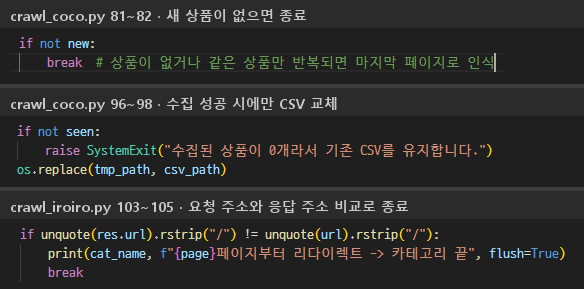
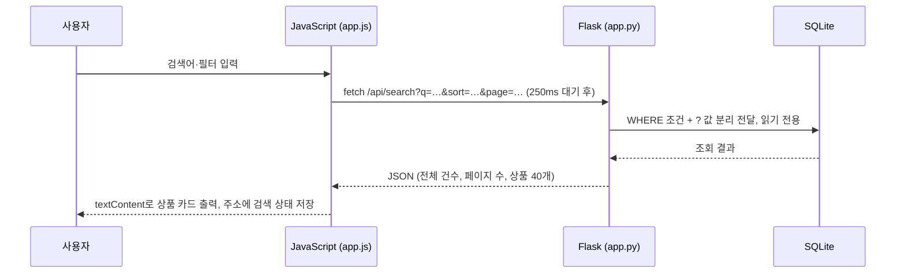
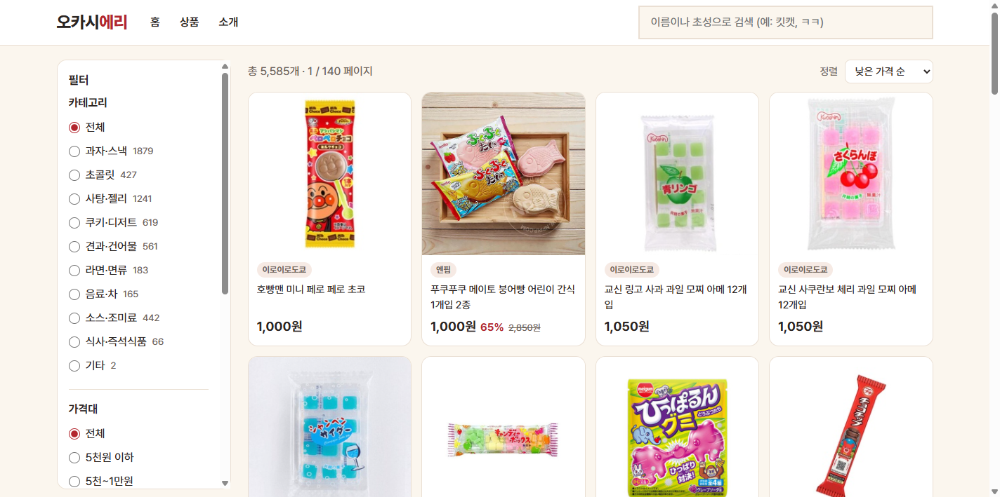
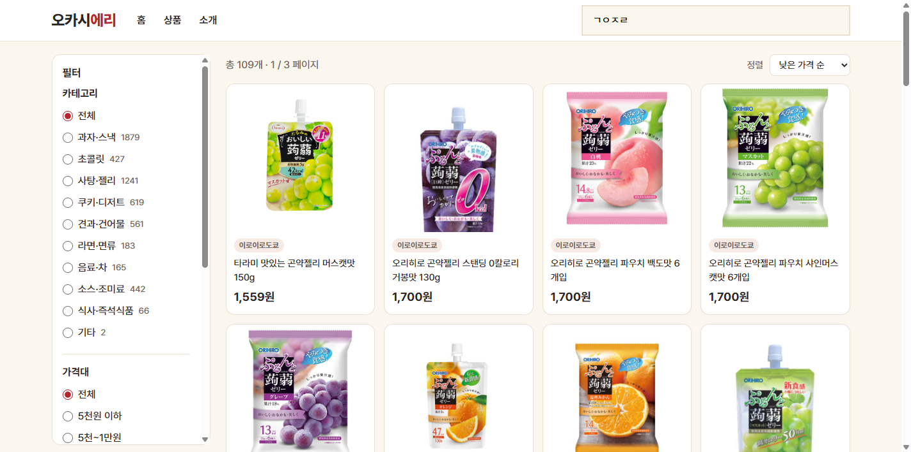

# 오카시에리 (Okashieri)

일본 과자 직구 쇼핑몰 3곳(코코재팬, 엔핍, 이로이로도쿄)의 상품을 한곳에서 검색하고 가격순으로 비교하는 웹사이트입니다.

> 쇼핑몰 데이터 수집·정제 → SQLite DB 구축 → Flask 기반 검색 서비스 구현

포트폴리오용 비공개 저장소입니다. 수집한 데이터는 개인 학습·시연 용도입니다.



| 항목 | 내용 |
|---|---|
| 문제 | 최저가 확인을 위한 사이트별 개별 접속·검색과 가격의 수동 비교 반복, 사이트별 상이한 표기·분류 기준으로 인한 동일 상품 비교의 어려움 |
| 목표 | 다수 쇼핑몰 상품의 통합 검색·가격순 비교를 통한 최저가 확인 서비스 구축 |
| 결과 | 쇼핑몰 3곳의 상품 5,585건을 하나의 DB로 모아 이름·초성 검색, 분류·가격대·할인율·쇼핑몰 필터, 가격순 정렬 제공, 매주 자동 갱신 |
| 기술 | requests · BeautifulSoup · Selenium · Python · SQLite · Flask · JavaScript · GitHub Actions |

## 전체 구조



| 단계 | 파일 | 하는 일 |
|---|---|---|
| 데이터 수집 | `check_robots.py`, `crawl_coco.py`, `crawl_nppip.py`, `crawl_iroiro.py` | 수집 허용 확인, 쇼핑몰별 상품 수집 |
| 데이터 정제 | `okashieri/build_db.py`, `okashieri/categorize.py` | 가격 정수 변환, 중복 제거, 공통 분류·다중 분류 |
| DB 구축 | `okashieri/build_db.py` | `products` 표 생성과 저장 |
| 검색 서비스 | `okashieri/app.py`, `okashieri/static/app.js` | 검색 API와 화면 |
| 자동화 | `.github/workflows/weekly-crawl.yml` | 매주 수집 → DB 생성 → 상품 수 검증 |

## 기술 선택 근거

| 단계 | 기술 | 선택 근거 |
|---|---|---|
| 수집 | requests | 브라우저 실행 과정이 없어 Selenium 대비 빠른 처리 속도, 기본 수집 도구로 우선 적용 |
| 수집 | Selenium | requests 응답에 상품 목록이 없는 페이지(엔핍) 한정 적용, 접속 후 3초 대기 후 수집 |
| 정제·저장 | Python 기본 모듈(re · csv · sqlite3) | 정수 변환·CSV 읽기·DB 저장을 별도 설치 없이 처리 |
| 저장 | SQLite | 별도 DB 서버 불필요, 파일 하나로 관리, 단순 구조·소규모 데이터(5,585건)에 적합 |
| 서비스 | Flask | 수집·정제와 같은 Python 기반 웹 서버, 개발 언어 일원화 |
| 서비스 | JavaScript | 검색 결과 데이터(JSON) 수신 후 상품 목록 영역만 갱신, 필터 변경 시 현재 화면 유지 |

## 1. 데이터 수집

### 사이트 구조 분석

개발자도구(F12)로 상품 카드 하나의 HTML 구조를 확인하고, 상품 하나를 감싸는 반복 태그 단위로 수집했습니다.



빨간 박스: 상품 카드(`li.sct_li`) · 상품명(`sct_txt`) · 정가(`coco2-was`)·할인가(`coco2-now`)

| 사이트 | 유형 | 수집 도구 | 다음 페이지 요청 주소 |
|---|---|---|---|
| 코코재팬 | 정적 | requests | '더보기' 버튼의 내부 주소(AJAX) `.../list_more_ajax.php?page=N` |
| 이로이로도쿄 | 정적 | requests | 경로 번호 `.../page/N/` |
| 엔핍 | 동적 | Selenium | URL 파라미터 `.../list.php?page=N` |

세 쇼핑몰 모두 목록 주소의 페이지 번호(N)만 바꾸면 다음 페이지를 받을 수 있는 구조라, N을 1부터 올려 가며 반복 요청하는 방식으로 자동 수집했습니다.

### 자동 수집 절차

| 단계 | 내용 |
|---|---|
| 목록 페이지 요청 | 요청 주소 기준, N=1부터 순차 요청 |
| 상품 정보 추출 | 상품 카드별 상품명·정가·할인가·이미지·링크 추출 (BeautifulSoup) |
| 신규 상품 기록 | 수집 완료 상품 주소(`seen`) 대조, 처음 나온 상품만 CSV 기록 |
| 페이지 번호 증가 | N+1 적용 후 목록 페이지 요청부터 반복 |
| 수집 종료 | 신규 상품 미발견 또는 비정상 응답 시 반복 중단, 기존 CSV 교체 |

```python
# crawl_coco.py 수집 반복부 (요청 주소 계산·이미지 저장·대기 시간 생략)
seen = set()                     # 수집 완료 상품 주소
page = 1
while page <= HARD_LIMIT:
    res = get_with_retry(url, ...)               # 목록 페이지 요청
    if res.status_code != 200:
        break                                    # 비정상 응답 시 종료
    soup = BeautifulSoup(res.text, "lxml")
    cards = soup.find_all('li', ...)             # 상품 카드별 정보 추출
    items = [parse_card(p) for p in cards]
    new = [it for it in items if it[4] not in seen]
    if not new:
        break                                    # 신규 상품 미발견 시 종료
    ...                                          # seen 추가, CSV 기록
    page += 1                                    # 페이지 번호 증가
```

**매회 전체 재수집 방식:** 수집할 때마다 CSV를 임시 파일에 처음부터 새로 쓰고, 끝까지 성공했을 때만 기존 파일과 교체합니다. 판매가 끝난 상품은 자동으로 빠지고 가격은 항상 최신 값이 되며, 수집이 중간에 실패해도 기존 데이터가 그대로 남습니다.

### 정적·동적 판별에 따른 수집 방법

같은 페이지를 requests와 Selenium으로 각각 받아 상품 개수를 비교해 판별했습니다. 엔핍은 requests 응답에 상품이 0개였고(상품 목록을 자바스크립트가 나중에 만드는 구조), Selenium으로 페이지를 연 뒤 3초 기다렸다가 수집합니다. HTML을 얻는 방법만 다르고, 상품 카드를 찾는 방법은 같습니다.

```python
# crawl_coco.py (정적): requests 응답 HTML 바로 분석
soup = BeautifulSoup(res.text, "lxml")
cards = soup.find_all('li', attrs={'class': 'sct_li'})

# crawl_nppip.py (동적): 브라우저로 접속, 3초 대기 후 분석
driver.get(url_page)
time.sleep(3)
soup = BeautifulSoup(driver.page_source, "lxml")
cards = soup.find_all('div', attrs={'class': 'item-row'})
```

### 수집 허용 여부 확인

접속 가능(상태코드 200)과 수집 허용은 다르기 때문에, robots.txt를 파싱해 수집할 주소마다 `can_fetch()`로 허용 여부를 판단합니다. 재팬푸드몰은 사이트 전체가 금지라 서비스에서 제외했고, 매주 수집 직전에 자동으로 확인해 허용되지 않으면 수집을 멈춥니다.





### 종료 조건 설계

| 상황 | 대응 |
|---|---|
| 실제 마지막 페이지 수를 미리 알 수 없음 | 페이지 수를 고정하지 않고 '신규 상품 미발견' 기준으로 종료 |
| 마지막 페이지 이후 메인 페이지로 이동(상태코드 200 유지) | 요청 주소와 응답 주소(`res.url`) 비교로 종료 |
| 수집 도중 실패 | 성공 시에만 CSV 교체, 상품 3,000건 미만이면 새 DB 사용 안 함 |



## 2. 데이터 정제와 분류

DB로 만들기 전에 형식을 맞추고 중복과 과자 외 상품을 걸러 내는 전처리입니다.

| 정제 항목 | 문제 상황 | 처리 방법 |
|---|---|---|
| 가격 | 가격 형식 불일치('원'·쉼표 포함 문자열), 가격순 정렬·할인율 계산 불가 | 숫자 추출 후 정수 변환 |
| 중복 | 동일 페이지 반복 응답·재수집 시 상품 중복 저장 가능성 | 수집 단계: 상품 주소 기준 1회 기록 / DB 단계: 쇼핑몰+상품 주소 `UNIQUE` 제약 이중 차단 (최종 중복 0건) |
| 과자 외 상품 | 과자 쇼핑몰 내 화장품·양말·파우치 판매 | 롬앤·라인삭스·메쉬파우치 포함 상품명 제외 |
| 분류 정의 | 쇼핑몰별 분류 부재, 명칭 상이 | 공통 분류 10개 정의, 분류별 키워드 목록 작성, 키워드 포함 시 해당 분류 |
| 다중 키워드 | 상품명 내 여러 분류 키워드 포함 (예: '초코 쿠키') | 지정 키워드 포함 시 해당 분류 다중 적용, 분류 칼럼 2개(`main_category`·`sub_category`)에 저장 |

**다중 분류 키워드를 고른 기준:** 상품명에 걸리는 키워드를 전부 분류로 쓰면 1,401개 상품에 "가루비"(과자 브랜드)가 '가루' 때문에 소스로 잡히는 식의 오분류가 생겼습니다. 그래서 초코·쿠키·땅콩·젤리처럼 그 자체로 상품 종류인 단어만 다중 분류에 쓰도록 좁혔고, 303개 상품이 두 분류에서 함께 검색됩니다.

```python
# build_db.py: 가격 문자열 → 정수
def parse_price(text):
    digits = re.sub(r'[^\d]', '', text or '')
    return int(digits) if digits else None

# categorize.py: 지정 키워드 포함 시 다중 분류
def sub_categories(name, main):
    text = clean(name)
    return [cat for cat, words in SUB_RULES if cat != main and any(w in text for w in words)]
```

| 정제 전 (CSV 원본) | 정제 후 (DB 저장 값) |
|---|---|
| `칸토리맘 바닐라/초코 쿠키 18개입,"7,500원","5,900원",…` | `orig_price` 7500 · `sale_price` 5900 · `discount_pct` 21 · `main_category` 쿠키·디저트 · `sub_category` 초콜릿 |

## 3. DB 설계와 구축

`products` 표 하나에, 칼럼마다 저장할 때 처리와 조회할 때 쓰임을 정해 두었습니다.

| 구분 | 칼럼 | 저장 처리 (`build_db.py`) | 조회 활용 (`app.py`) |
|---|---|---|---|
| 식별 | `site` · `site_label` · `url` | 쇼핑몰 코드·이름, 상품 주소 (`UNIQUE(site, url)` 중복 차단) | 쇼핑몰 필터, 상품 페이지 이동 |
| 상품 | `name` · `image` | 원본 상품명, 이미지 파일 경로 | 상품 카드 표시 |
| 가격 | `orig_price` · `sale_price` · `discount_pct` | 문자열 가격 정수 변환, 할인율 계산 | 가격대·할인율 필터, 가격순 정렬 |
| 분류 | `category` · `main_category` · `sub_category` | 쇼핑몰 자체 분류, 키워드 기반 공통 분류 | 분류 필터 (두 분류 칼럼 OR) |
| 검색용 | `name_norm` · `name_cho` | 공백 제거·소문자 변환 이름, 초성 | 상품명·초성 부분 일치 검색 |

**저장 쿼리** (`build_db.py`): 정제 완료 상품 1건을 `products` 표 1행으로 추가합니다. DB를 만들 때 상품마다 1회 실행합니다.

```sql
INSERT INTO products
  (site, site_label,                      -- 식별: 쇼핑몰 코드·쇼핑몰명
   category, main_category, sub_category, -- 분류: 쇼핑몰 자체 분류·공통 분류
   name,                                  -- 상품: 원본 상품명
   orig_price, sale_price, discount_pct,  -- 가격: 정가·판매가·할인율
   image,                                 -- 상품: 이미지 경로
   url,                                   -- 식별: 상품 주소
   name_norm, name_cho)                   -- 검색용: 공백 제거 이름·초성
VALUES (?, ?, ?, ?, ?, ?, ?, ?, ?, ?, ?, ?, ?)  -- 칼럼 순서별 정제 값 13개
```

- `?` 자리표시자: 값과 SQL 명령을 분리해 전달
- 동일 쇼핑몰·상품 주소 재저장 시 `UNIQUE` 제약 위반으로 중복 행 생성 차단

**조회 쿼리** (`app.py`): 화면에서 고른 검색어·필터 값으로 상품을 찾습니다. 검색 요청마다 실행합니다.

```sql
SELECT site_label, name, image, url,           -- 화면 표시 칼럼 7개
       orig_price, sale_price, discount_pct     -- (식별·상품·가격)
FROM products
WHERE (main_category = ? OR sub_category LIKE ?)  -- 분류: 분류 조건
  AND name_norm LIKE ?                            -- 검색용: 검색어 조건
  AND sale_price <= ?                             -- 가격: 판매가 상한
ORDER BY sale_price ASC                           -- 가격: 판매가 오름차순
LIMIT ? OFFSET ?                                  -- 페이지당 40건 조회
```

- `SELECT`: 저장 칼럼 13개 중 화면 표시 칼럼 7개만 조회, 분류·검색용·쇼핑몰 코드 칼럼은 조건 전용
- `WHERE`: 화면에서 선택한 조건만 AND로 결합, 분류는 두 칼럼 중 하나만 맞아도 포함(OR)
- `LIMIT` · `OFFSET`: 페이지당 40건 조회, 결과는 JSON으로 화면에 전달
- 매주 수집 후 새 DB를 만들고, 상품이 3,000건 미만이면 실패 처리합니다.

## 4. 검색 서비스 구현



### 화면

| 상품 목록 (필터·정렬) | 초성 검색 (ㄱㅇㅈㄹ → 곤약젤리) |
|---|---|
|  |  |

### 설계에서 고려한 것

| 백엔드 · Flask | 프론트엔드 · JavaScript |
|---|---|
| 검색 조건별 WHERE 조립, 값은 `?` 파라미터로 분리 전달 (SQL 주입 차단) | 필터 변경 시 fetch로 데이터만 요청, 목록 부분만 다시 그림 |
| 정렬 기준은 허용 목록에서만 선택 (`ORDER BY`에는 `?` 사용 불가) | 입력 후 250ms 대기 뒤 요청, 늦게 도착한 이전 응답은 버림 |
| 읽기 전용 DB 연결(`mode=ro`), 범위를 넘는 페이지는 마지막 페이지로 보정 | 모든 글자를 `textContent`로 출력 (외부 상품명 속 스크립트 실행 차단) |
| 응답: 전체 건수·페이지 수·상품 40개의 JSON | 검색 상태를 주소(URL)에 저장 → 새로고침·링크 공유 시 유지 |

```python
# app.py: 분류 필터(두 분류 칼럼 OR), 초성 검색, 허용 목록 정렬
clauses.append("(main_category = ? OR sub_category LIKE ?)")
column = "name_cho" if all(ch in CHO for ch in token) else "name_norm"
order_by = SORTS.get(sort, SORTS["discount"])
```

## 5. 문제 해결: 자동 수집 서버 접속 차단

| 단계 | 내용 |
|---|---|
| 문제 상황 | 주간 자동 수집(GitHub Actions 서버)에서 코코재팬만 접속 거부(응답코드 403), 같은 코드를 PC에서 실행하면 정상 접속·수집 |
| 원인 확인 | 코드 문제·robots.txt 거부·실행 환경 차이를 나눠 확인. User-Agent를 바꿔도 동일했고, 차단 응답 헤더 `cf-mitigated: challenge`로 Cloudflare 봇 판별 단계 적용 확인 |
| 해결 | 보안 장치 우회 배제, 코코재팬은 PC 수집 데이터 사용, 그 외 쇼핑몰은 GitHub Actions 자동 수집 유지 |

## 설계 선택과 한계

| 설계 선택 | 선택 이유 | 한계 | 확장 방안 |
|---|---|---|---|
| 매회 전체 재수집·DB 재생성 | 최신 가격 유지, 판매 종료 상품 자동 제외, 단순 구조·소규모 데이터 | 이전 가격 미보관, 가격 변동 추이 확인 불가 | 수집 일자 칼럼 추가·누적 저장 시 가격 변동 분석 가능 |

## 실행

```bash
git clone https://github.com/seo941024/Crawling.git
cd Crawling
pip install -r okashieri/requirements.txt
cd okashieri
python app.py        # http://127.0.0.1:5000
```

- CSV 3개와 `okashieri/okashieri.db`는 저장소에 포함되어 있어 바로 실행됩니다.
- **상품 이미지는 저장소에 없습니다**(용량·저작권). 수집 스크립트를 돌리면 받아지고, 없으면 화면에 "이미지 없음"으로 표시됩니다.
- 엔핍 수집에는 Chrome이 필요합니다.
- 수집 스크립트는 `--out-dir`(저장 폴더)와 `--max-pages`(시험 실행용)를 받습니다.

## 주간 자동 수집

GitHub Actions가 쇼핑몰별 robots.txt 확인 → 수집 → 새 DB 생성 → 상품 수 검증 순서로 실행하고, DB와 CSV를 결과물(Artifacts)로 30일 보관합니다. 코코재팬은 GitHub 서버 접속이 막혀 건너뛰고 저장소의 CSV를 사용합니다(PC에서 수집해 올림). Actions 화면에서 **Run workflow**로 수동 실행도 할 수 있습니다.

## 주의

- 쇼핑몰 약관이 정보의 복제·제공을 제한할 수 있으므로 공개하지 않습니다.
- README 화면 캡처에는 쇼핑몰 상품 이미지가 들어 있어, 저장소를 공개로 바꾸기 전에는 교체해야 합니다.
- 프로젝트 이름과 코드 폴더 이름은 모두 오카시에리(Okashieri), `okashieri/`입니다.
- 재팬푸드몰(robots.txt가 크롤러를 전부 금지)과 구루메상(운영 중단)은 서비스에서 제외했습니다. 두 곳의 수집 원본 CSV는 기록용으로만 저장소에 있고, 자동 수집과 사이트에는 쓰이지 않습니다.
