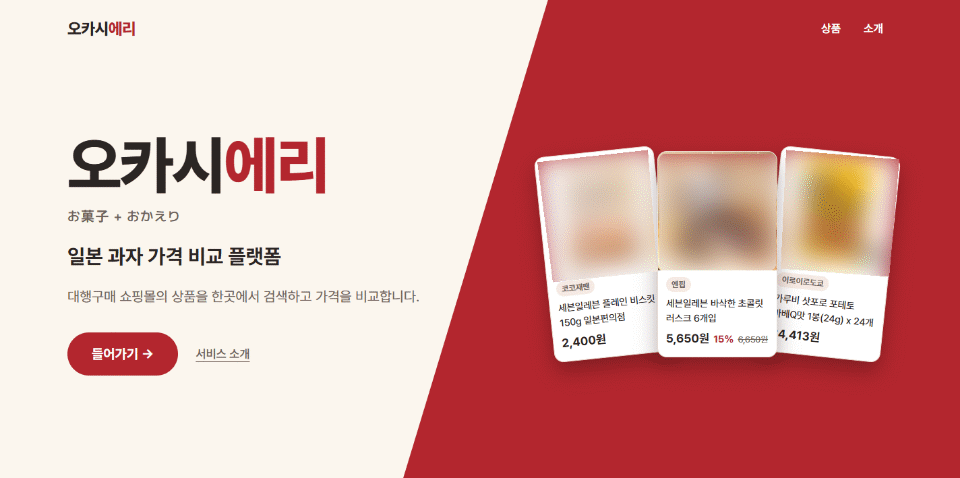
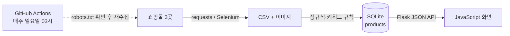
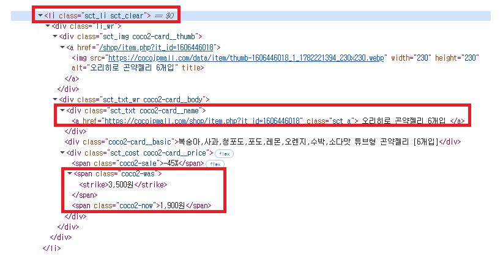
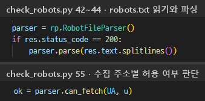
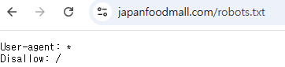
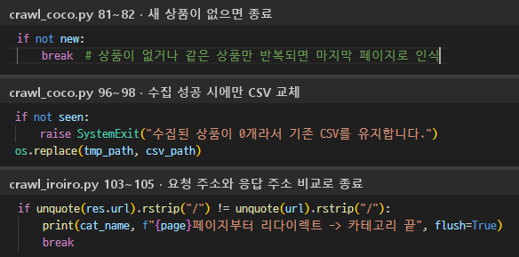
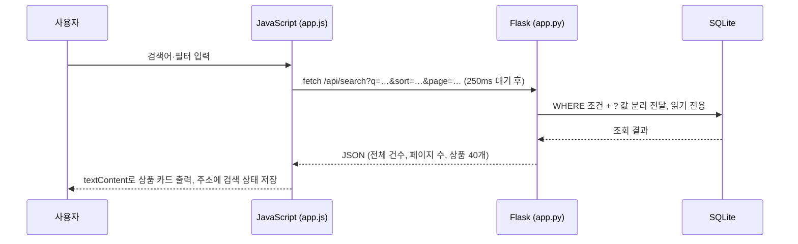
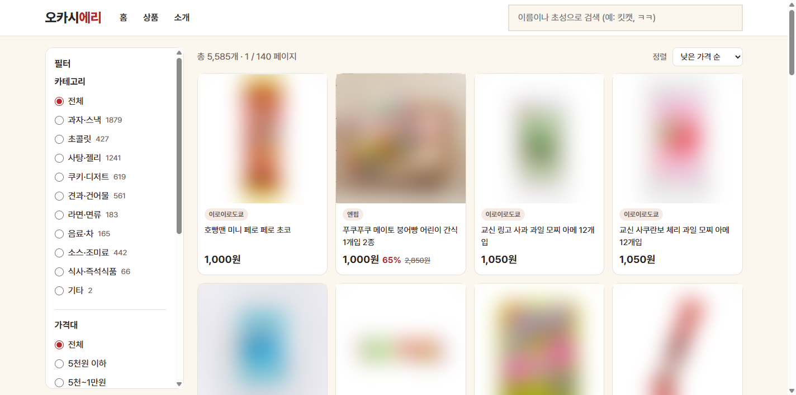
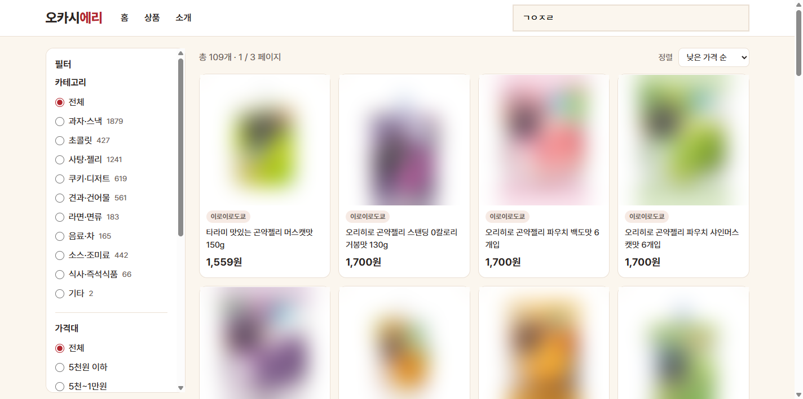

# 오카시에리 · Okashieri

일본 과자 직구 쇼핑몰 코코재팬·엔핍·이로이로도쿄의 상품을 한곳에서 검색하고 가격순으로 비교하는 웹사이트.

> 쇼핑몰 데이터 수집·정제 → SQLite DB 구축 → Flask 기반 검색 서비스 구현

개인 프로젝트 포트폴리오 저장소. 수집한 데이터는 학습·시연 용도로만 사용하고 서비스로 운영하지 않음.



*화면 순서: 시작 화면 → 상품 목록(필터·가격순 정렬) → 초성 검색(ㄱㅇㅈㄹ → 곤약젤리). 상품 사진은 흐리게 처리.*

| 항목 | 내용 |
|---|---|
| 목표 | 다수 쇼핑몰 상품의 통합 검색·가격순 비교를 통한 최저가 확인 서비스 구축 |
| 결과 | 쇼핑몰 3곳의 상품을 하나의 DB로 모아 이름·초성 검색, 분류·가격대·할인율·쇼핑몰 필터, 가격순 정렬 제공, 매주 자동 수집·새 DB 생성 |
| 기술 | requests · BeautifulSoup · Selenium · Python · SQLite · Flask · JavaScript · GitHub Actions |

## 기획 과정

| 단계 | 내용 |
|---|---|
| 문제 발견 | 일본 과자 직구 이용 중 발견, 최저가 확인을 위한 사이트별 개별 접속·검색과 가격의 수동 비교 반복, 사이트별 상이한 분류 기준으로 인한 종류별 상품 비교의 어려움 |
| 기존 사례 | 다나와·에누리: 같은 상품의 판매처 묶음 가격 비교, 코코재팬·엔핍·이로이로도쿄는 판매처 목록에 없음 / 쇼핑몰별 검색: 상품명 검색 한정, 초성 검색 미지원, 다른 쇼핑몰 가격 비교 불가 |
| 개선 방향 | 쇼핑몰 3곳 상품 통합 검색·가격순 비교, 최저가 자동 선택 대신 비교 후 쇼핑몰 상품 페이지 이동 |
| 차별점 | 일반 가격 비교 서비스 판매처 목록에 없는 쇼핑몰 3곳 통합 비교, 쇼핑몰마다 다른 분류의 공통 분류 10개 통일, 초성 검색 |

*기존 사례: 2026년 11월 확인 기준 ([다나와](https://search.danawa.com/dsearch.php?query=%EC%9D%B4%EB%A1%9C%EC%9D%B4%EB%A1%9C%EB%8F%84%EC%BF%84)·[에누리](https://price.enuri.com/search?keyword=%EC%9D%B4%EB%A1%9C%EC%9D%B4%EB%A1%9C%EB%8F%84%EC%BF%84) 쇼핑몰 이름 검색, 쇼핑몰별 초성 검색).*

## 전체 구조



| 단계 | 파일 | 하는 일 |
|---|---|---|
| 데이터 수집 | `check_robots.py`, `crawl_coco.py`, `crawl_nppip.py`, `crawl_iroiro.py` | 수집 허용 확인, 쇼핑몰별 상품 수집 |
| 데이터 정제 | `okashieri/build_db.py`, `okashieri/categorize.py` | 가격 정수 변환, 중복 제거, 공통 분류·다중 분류 |
| DB 구축 | `okashieri/build_db.py` | `products` 표 생성과 저장 |
| 검색 서비스 | `okashieri/app.py`, `okashieri/static/app.js` | 검색 API와 화면 |
| 자동화 | `.github/workflows/weekly-crawl.yml` | 매주 수집 → DB 생성 → 상품 수 검증 |

## 기술 선택 근거

| 단계 | 기술 | 선택 근거 |
|---|---|---|
| 수집 | requests | 브라우저 실행 과정이 없어 Selenium 대비 빠른 처리 속도, 기본 수집 도구로 우선 적용 |
| 수집 | Selenium | requests 응답에 상품 목록이 없는 엔핍 페이지 한정 적용, 접속 후 3초 대기 뒤 수집 |
| 수집 | 매주 배치 수집 | 사용자 접속마다 실시간 수집하는 방식 대비 빠른 응답, 쇼핑몰 부담 감소 |
| 정제·저장 | Python 기본 모듈 re · csv · sqlite3 | 정수 변환·CSV 읽기·DB 저장을 설치 없이 처리 |
| 저장 | SQLite | DB 서버 불필요, 파일 하나로 관리, 단순 구조·소규모 데이터에 적합 |
| 서비스 | Flask | 수집·정제와 같은 Python 기반 웹 서버, 개발 언어 일원화, Streamlit 대비 화면·서버 구조 설계 가능 |
| 서비스 | JavaScript | JSON 검색 결과 데이터 수신 후 상품 목록 영역만 갱신, 필터 변경 시 현재 화면 유지, 단순한 화면이라 빌드가 필요한 프레임워크 대신 순수 JavaScript 사용 |
| 자동화 | GitHub Actions | 처음 계획한 APScheduler·작업 스케줄러 대비 PC 상시 가동 불필요, GitHub 서버에서 매주 예약 실행·수동 실행 지원, DB·CSV 수집 결과 30일 보관 |

## 1. 데이터 수집

### 사이트 구조 분석

F12 개발자도구로 상품 카드 하나의 HTML 구조 확인, 상품 하나를 감싸는 반복 태그 단위로 수집.



빨간 박스: 상품 카드 `li.sct_li` · 상품명 `sct_txt` · 정가 `coco2-was` · 할인가 `coco2-now`

| 사이트 | 유형 | 수집 도구 | 다음 페이지 요청 주소 |
|---|---|---|---|
| 코코재팬 | 정적 | requests | '더보기' 버튼의 AJAX 내부 주소 `.../list_more_ajax.php?page=N` |
| 이로이로도쿄 | 정적 | requests | 경로 번호 `.../page/N/` |
| 엔핍 | 동적 | Selenium | URL 파라미터 `.../list.php?page=N` |

세 쇼핑몰 모두 목록 주소의 페이지 번호 N 변경만으로 다음 페이지를 받는 구조, N을 1부터 올려 가는 반복 요청 방식의 자동 수집.

### 자동 수집 절차

| 단계 | 내용 |
|---|---|
| 목록 페이지 요청 | 요청 주소 기준, N=1부터 순차 요청, 요청 사이 무작위 대기로 서버 부담 감소 |
| 상품 정보 추출 | BeautifulSoup으로 상품 카드별 상품명·정가·할인가·이미지·링크 추출 |
| 신규 상품 기록 | 수집 완료 상품 주소 `seen` 대조, 처음 나온 상품만 CSV 기록 |
| 페이지 번호 증가 | N+1 적용 후 목록 페이지 요청부터 반복 |
| 수집 종료 | 신규 상품 미발견 시 반복 종료 후 기존 CSV 교체, 비정상 응답 시 수집 중단·기존 CSV 유지 |

```python
# crawl_coco.py 수집 반복부 (요청 주소 계산·이미지 저장·대기 시간 생략)
seen = set()                     # 수집 완료 상품 주소
page = 1
while page <= HARD_LIMIT:
    res = get_with_retry(url, ...)               # 목록 페이지 요청
    if res.status_code != 200:
        break                                    # 비정상 응답 시 종료
    soup = BeautifulSoup(res.text, "lxml")
    cards = soup.find_all('li', ...)             # 상품 카드별 정보 추출
    items = [parse_card(p) for p in cards]
    new = [it for it in items if it[4] not in seen]
    if not new:
        break                                    # 신규 상품 미발견 시 종료
    ...                                          # seen 추가, CSV 기록
    page += 1                                    # 페이지 번호 증가
```

**매회 전체 재수집 방식:** 수집마다 CSV를 임시 파일에 처음부터 새로 작성, 끝까지 성공한 경우에만 기존 파일과 교체. 판매 종료 상품 제외, 가격은 수집 시점 값으로 갱신, 수집 중간 실패 시 기존 데이터 유지.

### 정적·동적 판별에 따른 수집 방법

같은 페이지를 requests와 Selenium으로 각각 받아 상품 개수 비교로 판별. 엔핍은 상품 목록을 자바스크립트가 나중에 만드는 구조라 requests 응답의 상품 0개, Selenium으로 페이지 접속 후 3초 대기 뒤 수집. HTML 획득 방법만 다르고 상품 카드 탐색 방법은 동일.

```python
# crawl_coco.py (정적): requests 응답 HTML 분석
soup = BeautifulSoup(res.text, "lxml")
cards = soup.find_all('li', attrs={'class': 'sct_li'})

# crawl_nppip.py (동적): 브라우저로 접속, 3초 대기 후 분석
driver.get(url_page)
time.sleep(3)
soup = BeautifulSoup(driver.page_source, "lxml")
cards = soup.find_all('div', attrs={'class': 'item-row'})
```

### 수집 허용 여부 확인

상태코드 200의 접속 가능과 수집 허용은 다른 문제라, robots.txt 파싱 후 쇼핑몰별 목록 페이지 주소마다 `can_fetch()`로 허용 여부 판단. 재팬푸드몰은 사이트 전체 금지로 서비스에서 제외, 매주 수집 직전 자동 확인 후 미허용 시 수집 중단.





### 종료 조건 설계

| 상황 | 대응 |
|---|---|
| 마지막 페이지 수를 미리 알 수 없음 | 페이지 수를 고정하지 않고 '신규 상품 미발견' 기준으로 종료 |
| 마지막 페이지 이후 메인 페이지로 이동, 상태코드 200 유지 | 요청 주소와 응답 주소 `res.url` 비교로 종료 |
| 수집 도중 실패 | 성공 시에만 CSV 교체, 상품 3,000건 미만이면 새 DB 사용 안 함 |



## 2. 데이터 정제와 분류

DB 구축 전 형식 통일, 중복·과자 외 상품 제거를 위한 전처리.

| 정제 항목 | 문제 상황 | 처리 방법 |
|---|---|---|
| 가격 | '원'·쉼표 포함 문자열의 가격 형식 불일치, 가격순 정렬·할인율 계산 불가 | 숫자 추출 후 정수 변환 |
| 중복 | 동일 페이지 반복 응답·재수집 시 상품 중복 저장 가능성 | 수집 단계: 상품 주소 기준 1회 기록 / DB 단계: 쇼핑몰+상품 주소 `UNIQUE` 제약 이중 차단, 최종 중복 0건 |
| 과자 외 상품 | 과자 쇼핑몰 내 화장품·양말·파우치 판매 | 롬앤·라인삭스·메쉬파우치 포함 상품명 제외 |
| 분류 정의 | 쇼핑몰별 분류 부재, 명칭 상이 | 공통 분류 10개 정의, 분류별 키워드 목록 작성, 키워드 포함 시 해당 분류 |
| 다중 키워드 | '초코 쿠키'처럼 상품명 내 여러 분류 키워드 포함 | 지정 키워드 포함 시 해당 분류 다중 적용, 분류 칼럼 2개 `main_category`·`sub_category`에 저장 |

**다중 분류 키워드를 고른 기준:** 상품명에 걸리는 키워드를 전부 분류로 쓰면 1,401개 상품에 과자 브랜드 "가루비"가 '가루' 때문에 소스로 잡히는 식의 오분류 발생. 초코·쿠키·땅콩·젤리처럼 상품 종류인 단어로 다중 분류 키워드 축소, 303개 상품은 두 분류에서 함께 검색.

```python
# build_db.py: 가격 문자열 → 정수
def parse_price(text):
    digits = re.sub(r'[^\d]', '', text or '')
    return int(digits) if digits else None

# categorize.py: 지정 키워드 포함 시 다중 분류
def sub_categories(name, main):
    text = clean(name)
    return [cat for cat, words in SUB_RULES if cat != main and any(w in text for w in words)]
```

| 정제 전 CSV 원본 | 정제 후 DB 저장 값 |
|---|---|
| `칸토리맘 바닐라/초코 쿠키 18개입,"7,500원","5,900원",…` | `orig_price` 7500 · `sale_price` 5900 · `discount_pct` 21 · `main_category` 쿠키·디저트 · `sub_category` 초콜릿 |

## 3. DB 설계와 구축

`products` 표 하나에 칼럼마다 저장 시 처리와 조회 시 쓰임 지정.

| 구분 | 칼럼 | `build_db.py` 저장 처리 | `app.py` 조회 활용 |
|---|---|---|---|
| 식별 | `site` · `site_label` · `url` | 쇼핑몰 코드·이름, 상품 주소, `UNIQUE(site, url)` 중복 차단 | 쇼핑몰 필터, 상품 페이지 이동 |
| 상품 | `name` · `image` | 원본 상품명, 이미지 파일 경로 | 상품 카드 표시 |
| 가격 | `orig_price` · `sale_price` · `discount_pct` | 문자열 가격 정수 변환, 할인율 계산 | 가격대·할인율 필터, 가격순 정렬 |
| 분류 | `category` · `main_category` · `sub_category` | 쇼핑몰 자체 분류, 키워드 기반 공통 분류 | 분류 필터, 두 분류 칼럼 OR 결합 |
| 검색용 | `name_norm` · `name_cho` | 공백 제거·소문자 변환 이름, 초성 | 상품명·초성 부분 일치 검색 |

**저장 쿼리:** `build_db.py`가 정제 완료 상품 1건을 `products` 표 1행으로 추가. DB 생성 시 상품마다 1회 실행.

```sql
INSERT INTO products
  (site, site_label,                      -- 식별: 쇼핑몰 코드·쇼핑몰명
   category, main_category, sub_category, -- 분류: 쇼핑몰 자체 분류·공통 분류
   name,                                  -- 상품: 원본 상품명
   orig_price, sale_price, discount_pct,  -- 가격: 정가·판매가·할인율
   image,                                 -- 상품: 이미지 경로
   url,                                   -- 식별: 상품 주소
   name_norm, name_cho)                   -- 검색용: 공백 제거 이름·초성
VALUES (?, ?, ?, ?, ?, ?, ?, ?, ?, ?, ?, ?, ?)  -- 칼럼 순서별 정제 값 13개
```

- `?` 자리표시자: 값과 SQL 명령을 분리해 전달
- 동일 쇼핑몰·상품 주소 재저장 시 `UNIQUE` 제약 위반으로 중복 행 생성 차단

**조회 쿼리:** `app.py`가 화면에서 고른 검색어·필터 값으로 상품 조회. 검색 요청마다 실행.

```sql
SELECT site_label, name, image, url,           -- 화면 표시 칼럼 7개
       orig_price, sale_price, discount_pct     -- (식별·상품·가격)
FROM products
WHERE (main_category = ? OR sub_category LIKE ?)  -- 분류: 분류 조건
  AND name_norm LIKE ?                            -- 검색용: 검색어 조건
  AND sale_price <= ?                             -- 가격: 판매가 상한
ORDER BY sale_price ASC                           -- 가격: 판매가 오름차순
LIMIT ? OFFSET ?                                  -- 페이지당 40건 조회
```

- `SELECT`: 저장 칼럼 13개 중 화면 표시 칼럼 7개만 조회, 분류·검색용·쇼핑몰 코드 칼럼은 조건 전용
- `WHERE`: 화면에서 선택한 조건만 AND로 결합, 분류는 두 칼럼 중 하나만 맞아도 포함하는 OR 조건
- `LIMIT` · `OFFSET`: 페이지당 40건 조회, 결과는 JSON으로 화면에 전달
- 매주 수집 후 새 DB 생성, 상품 3,000건 미만 시 실패 판정.

## 4. 검색 서비스 구현



### 화면

| 상품 목록, 필터·정렬 | 초성 검색, ㄱㅇㅈㄹ → 곤약젤리 |
|---|---|
|  |  |

### 설계에서 고려한 것

| 백엔드 · Flask | 프론트엔드 · JavaScript |
|---|---|
| 검색 조건별 WHERE 조립, SQL 주입 차단을 위한 `?` 파라미터 값 분리 전달 | 필터 변경 시 fetch로 데이터만 요청, 목록 부분만 다시 그림 |
| `ORDER BY`에 `?` 사용 불가로 정렬 기준은 허용 목록에서만 선택 | 입력 후 250ms 대기 뒤 요청, 늦게 도착한 이전 응답은 버림 |
| `mode=ro` 읽기 전용 DB 연결, 범위를 넘는 페이지는 마지막 페이지로 보정 | 모든 글자의 `textContent` 출력으로 외부 상품명 속 스크립트 실행 차단 |
| 응답: 전체 건수·페이지 수·상품 40개의 JSON | 검색 상태를 URL에 저장 → 새로고침·링크 공유 시 유지 |

```python
# app.py: 분류 필터(두 분류 칼럼 OR), 초성 검색, 허용 목록 정렬
clauses.append("(main_category = ? OR sub_category LIKE ?)")
column = "name_cho" if all(ch in CHO for ch in token) else "name_norm"
order_by = SORTS.get(sort, SORTS["discount"])
```

## 5. 문제 해결: 자동 수집 서버 접속 차단

| 단계 | 내용 |
|---|---|
| 문제 상황 | GitHub Actions 서버의 주간 자동 수집에서 코코재팬만 응답코드 403 접속 거부, 같은 코드의 PC 실행 시 정상 접속·수집 |
| 원인 확인 | 코드 문제·robots.txt 거부·실행 환경 차이를 나눠 확인. User-Agent 변경 후에도 동일, 차단 응답 헤더 `cf-mitigated: challenge`로 Cloudflare 봇 판별 단계 적용 확인 |
| 해결 | 보안 장치 우회 배제, 코코재팬은 PC 수집 데이터 사용, 그 외 쇼핑몰은 GitHub Actions 자동 수집 유지 |

## 설계 선택과 한계

| 설계 선택 | 선택 이유 | 한계 | 확장 방안 |
|---|---|---|---|
| 매회 전체 재수집·DB 재생성 | 최신 가격 유지, 판매 종료 상품 자동 제외, 단순 구조·소규모 데이터 | 이전 가격 미보관, 가격 변동 추이 확인 불가 | 수집 일자 칼럼 추가·누적 저장 시 가격 변동 분석 가능 |

## 실행

```bash
git clone https://github.com/seo941024/Crawling.git
cd Crawling
pip install -r okashieri/requirements.txt
cd okashieri
python app.py        # http://127.0.0.1:5000
```

- CSV 3개와 `okashieri/okashieri.db`는 저장소에 포함, 바로 실행 가능.
- **상품 이미지는 용량·저작권 사유로 저장소 미포함.** 수집 스크립트 실행 후 `okashieri` 폴더에서 `python build_db.py`로 DB를 다시 만들면 표시, 이미지가 없으면 화면에 "이미지 없음" 표시.
- 엔핍 수집에 Chrome 필요.
- 수집 스크립트 인자: 저장 폴더 `--out-dir`, 시험 실행용 `--max-pages`.

## 주간 자동 수집

GitHub Actions가 쇼핑몰별 robots.txt 확인 → 수집 → 새 DB 생성 → 상품 수 검증 순서로 실행, DB와 CSV는 Artifacts 결과물로 30일 보관. 코코재팬은 GitHub 서버 접속 차단으로 건너뛰고, PC에서 수집해 올린 저장소 CSV 사용. Actions 화면의 **Run workflow**로 수동 실행 가능.

## 주의

- 쇼핑몰 약관의 정보 복제·제공 제한 가능성으로, 사이트는 외부 배포 없이 학습·시연 용도로만 실행.
- README 화면 캡처의 상품 사진은 흐리게 처리.
- 프로젝트 이름 오카시에리 · Okashieri, 코드 폴더 이름 `okashieri/`로 통일.
- 재팬푸드몰은 robots.txt의 크롤러 전면 금지로 서비스에서 제외, 수집 데이터도 저장소에서 삭제.
- 구루메상은 운영 중단으로 서비스에서 제외. 수집 원본 CSV는 기록용으로만 보관, 자동 수집과 사이트에는 미사용.
