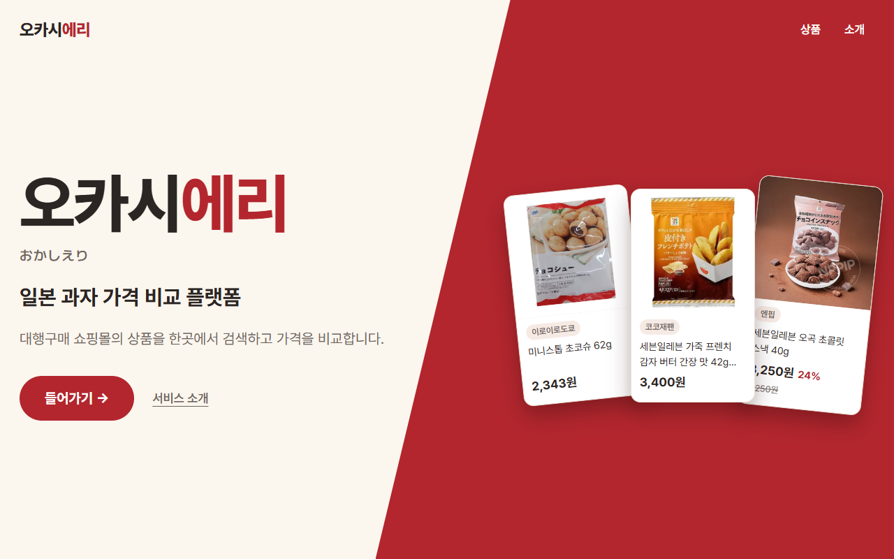
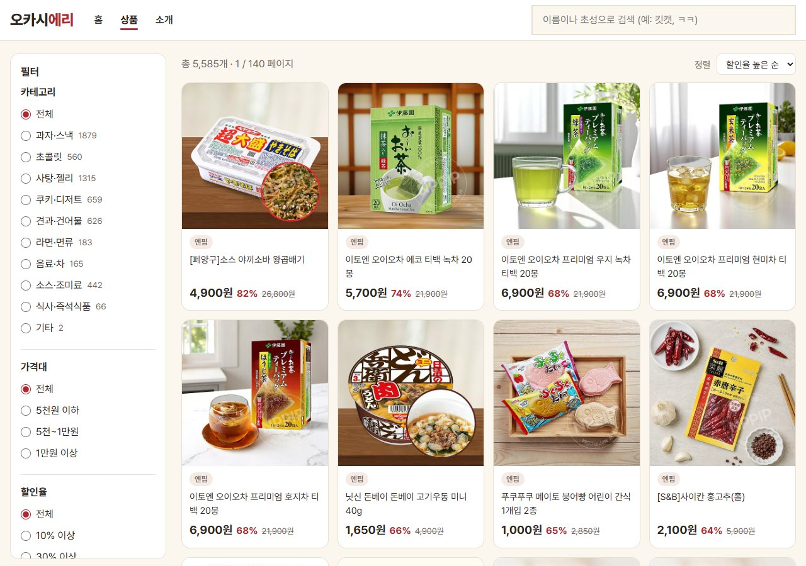
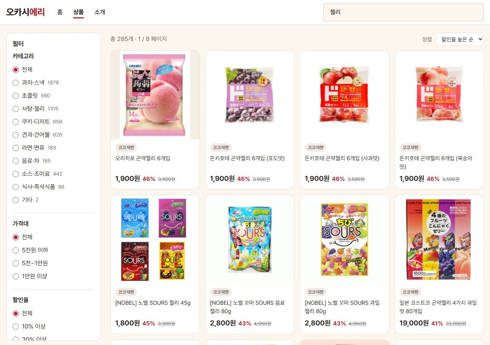
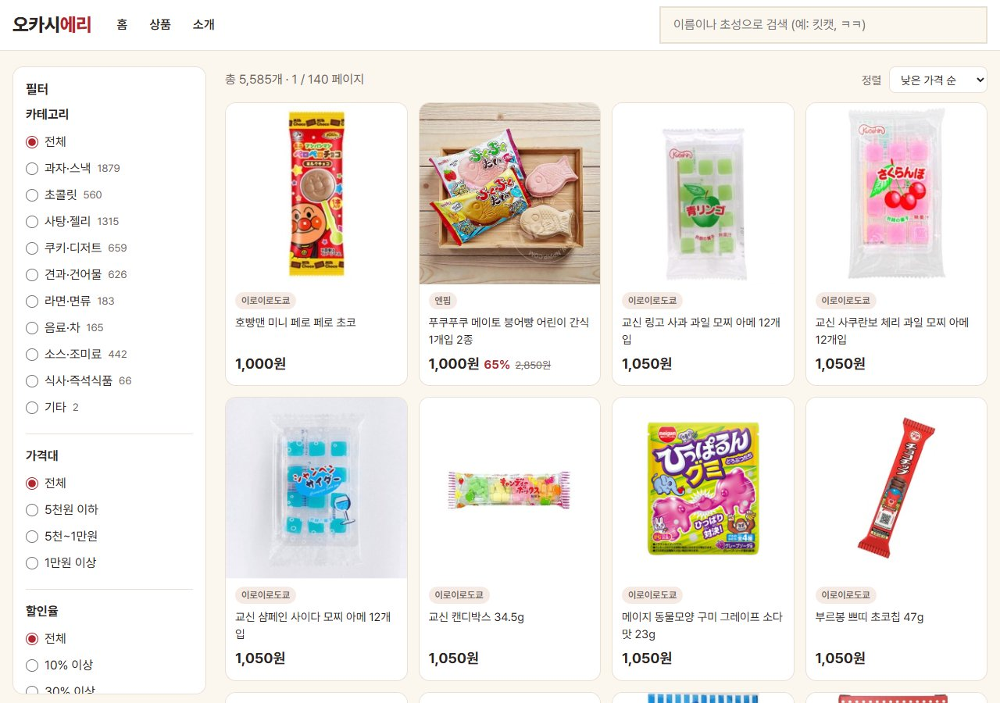
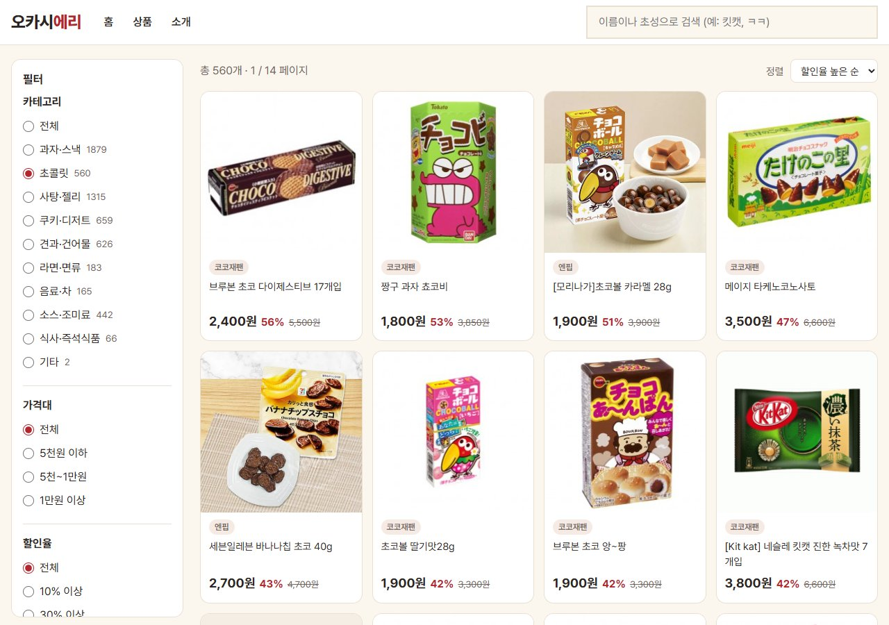
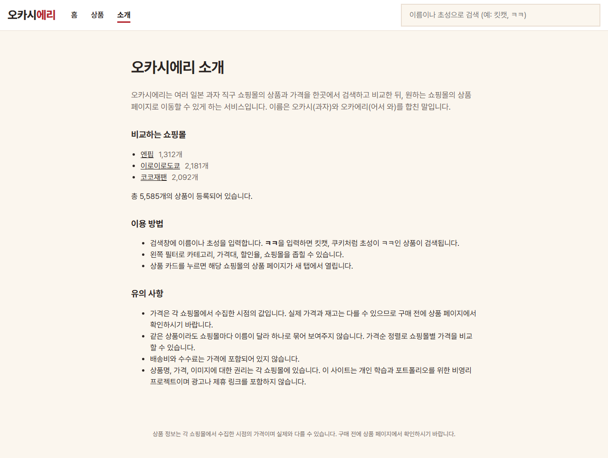
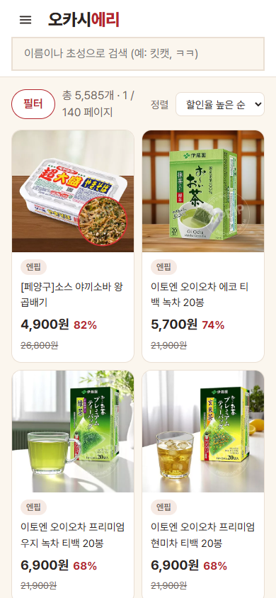
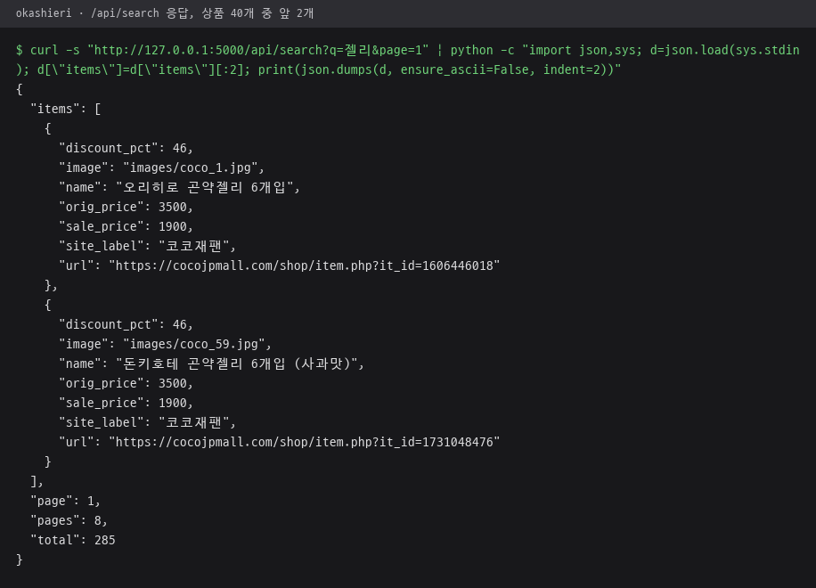

# okashieri · DB 구축과 검색 서비스

수집한 CSV를 정제해 SQLite DB를 만들고, Flask로 검색 화면과 JSON API를 제공하는 서비스 폴더.

수집 스크립트 `crawl_*.py`, `check_robots.py`는 저장소 루트에 위치. 프로젝트 전체 설명은 [루트 README](../README.md) 참고.

## 파일

| 파일 | 역할 |
|---|---|
| `app.py` | Flask 서버, 화면 라우트 3개와 JSON API 2개, 읽기 전용 DB 연결 |
| `build_db.py` | 루트의 쇼핑몰 CSV 3개 정제, `products` 표 생성, 상품 이미지를 `static/images/`로 복사 |
| `categorize.py` | 상품명 키워드 기반 공통 분류 10개·추가 분류 판정, 과자 외 상품 제외 규칙 |
| `okashieri.db` | `build_db.py`가 만든 SQLite DB, `app.py` 조회 대상 |
| `requirements.txt` | 수집·DB 생성·서비스 공통 패키지 목록 |
| `templates/` | Jinja2 화면 템플릿 4개, [templates/README.md](templates/README.md) 참고 |
| `static/` | 화면 스크립트와 스타일 |
| `DECISIONS.md` | 수집·정제·분류·검색·화면 설계의 선택 이유 기록 |
| `프로젝트_정리.md` | 진행 내용 요약 문서 |
| `title.png` | 시작 화면 캡처 |

## 화면

로컬에서 `python app.py`로 실행해 찍은 화면. 상품 이미지는 저장소에 없는 `static/images/`를 둔 상태.

| 시작 화면 `/` | 상품 화면 `/shop` |
|---|---|
|  |  |

| 검색어 젤리 | 낮은 가격 순 정렬 |
|---|---|
|  |  |

| 초콜릿 분류 필터 | 서비스 소개 `/about` |
|---|---|
|  |  |

| 너비 390px 상품 화면 |   |
|---|---|
|  |   |

## static

| 파일 | 역할 |
|---|---|
| `app.js` | 상품 화면의 검색·필터·정렬·페이지 이동, `/api/search` 호출, 검색 상태의 주소 저장 |
| `nav.js` | 상단 메뉴 열기·닫기, 현재 메뉴 강조 |
| `start.js` | 시작 화면 상품 카드를 5초마다 `/api/cards` 결과로 교체 |
| `style.css` | 상품 화면·소개 화면 공통 스타일, 색상 CSS 변수 |
| `start.css` | 시작 화면 전용 스타일 |

## API

| 주소 | 응답 |
|---|---|
| `/api/search` | 검색어·분류·가격대·할인율·쇼핑몰·정렬·페이지 조건 조회 결과, 전체 건수·페이지 수·페이지당 최대 40개 상품 |
| `/api/cards` | 쇼핑몰별 이미지 있는 무작위 상품 1개씩 |

`/api/search?q=젤리` 실제 응답. 상품 40개 중 앞 2개만 남겨 정리.

## 실행 흐름

1. 루트의 `crawl_*.py`로 쇼핑몰별 CSV 갱신
2. `python build_db.py`로 `okashieri.db` 재생성, 경로 인자 지정 시 시험용 DB 별도 생성
3. `python app.py`로 `http://127.0.0.1:5000` 실행

- `okashieri.db`와 CSV는 저장소에 포함, 2단계 없이 바로 실행 가능
- `static/images/` 상품 이미지는 저장소 미포함, 이미지가 없는 상품은 "이미지 없음" 표시
- `OKASHIERI_DB` 환경 변수로 `app.py`가 읽을 DB 경로 변경 가능
