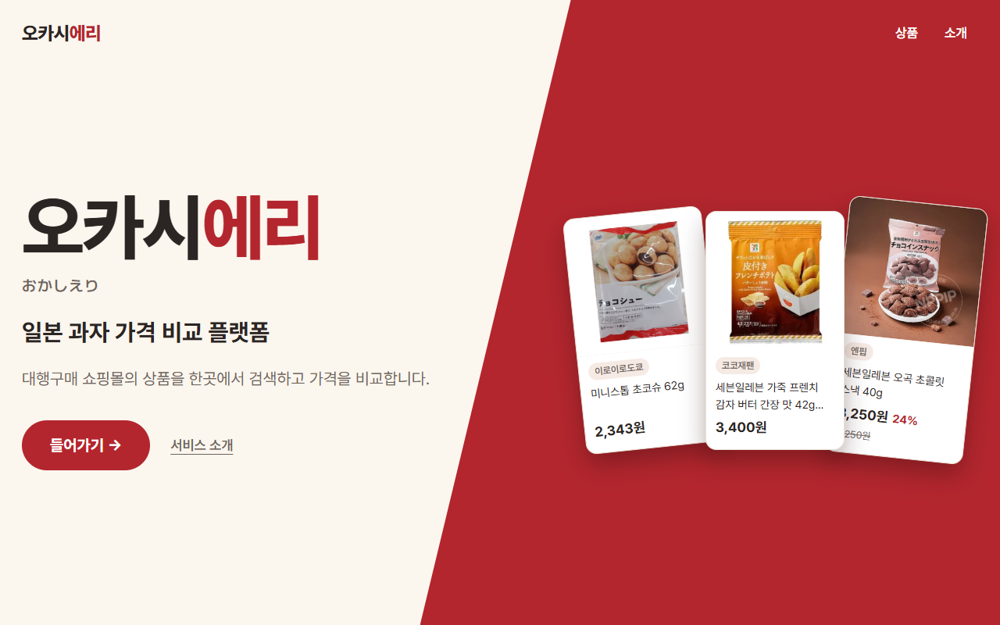
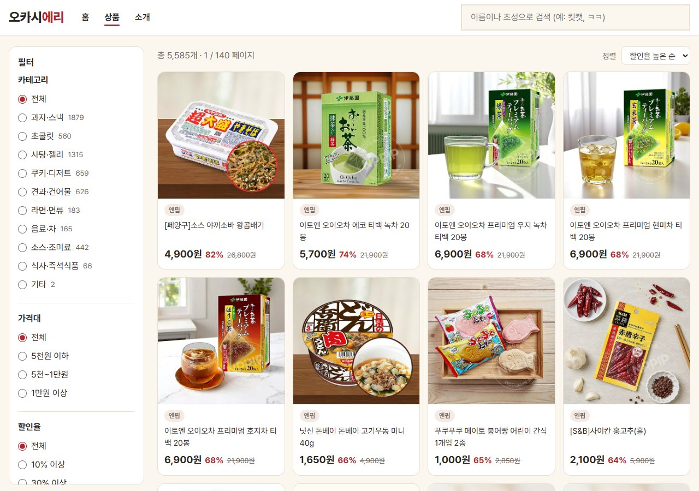
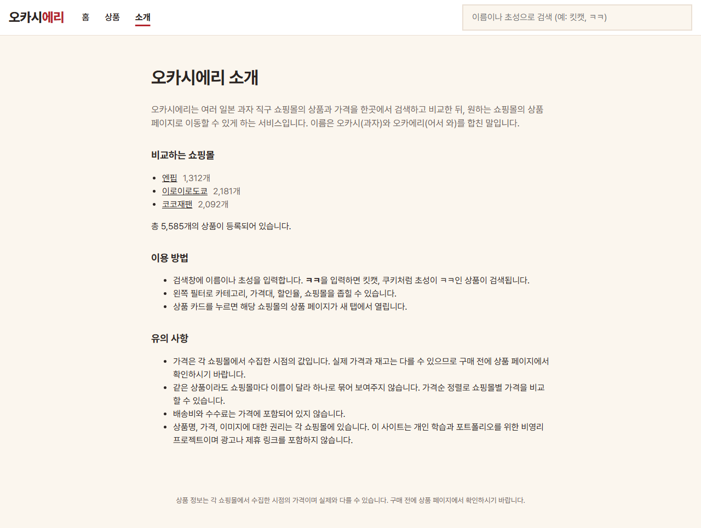

# templates · Flask 화면 템플릿

`app.py` 라우트가 렌더링하는 Jinja2 템플릿 폴더. 서비스 폴더 설명은 [상위 README](../README.md) 참고.

| 파일 | 라우트 | 화면 내용 |
|---|---|---|
| `base.html` | 직접 렌더링 없음 | `index.html`·`about.html` 공통 틀, 상단 로고·메뉴·검색창, 하단 가격 안내 문구, `nav.js` 로드 |
| `start.html` | `/` · `start()` | 시작 화면, 서비스 이름·소개 문구·들어가기 버튼, 쇼핑몰별 무작위 상품 카드, `start.js` 로드 |
| `index.html` | `/shop` · `index()` | 상품 검색 화면, 카테고리·가격대·할인율·쇼핑몰 필터 사이드바, 정렬 선택, 상품 목록·페이지 번호 영역, `app.js` 로드 |
| `about.html` | `/about` · `about()` | 서비스 소개, 쇼핑몰별 상품 수와 쇼핑몰 필터 링크, 전체 상품 수, 이용 방법, 유의 사항 |

## 템플릿 변수

| 템플릿 | 변수 | 내용 |
|---|---|---|
| `start.html` | `cards` | `random_cards()` 결과, 쇼핑몰별 이미지 있는 상품 1개씩 |
| `index.html` | `sites`, `categories` | 쇼핑몰별 상품 수, 상품이 있는 분류별 상품 수 |
| `about.html` | `sites`, `total` | 쇼핑몰별 상품 수, 전체 상품 수 |

## 참고

- `index.html`의 상품 목록은 서버 렌더링 없이 `static/app.js`가 `/api/search` JSON을 받아 `#results`, `#pager`에 출력
- `start.html`은 `base.html` 미상속, 별도 스타일 `start.css` 사용
- 상단 검색창은 `/shop?q=검색어` GET 요청으로 상품 화면 이동

## 화면

| `start.html` | `index.html` |
|---|---|
|  |  |

| `about.html` |   |
|---|---|
|  |   |
